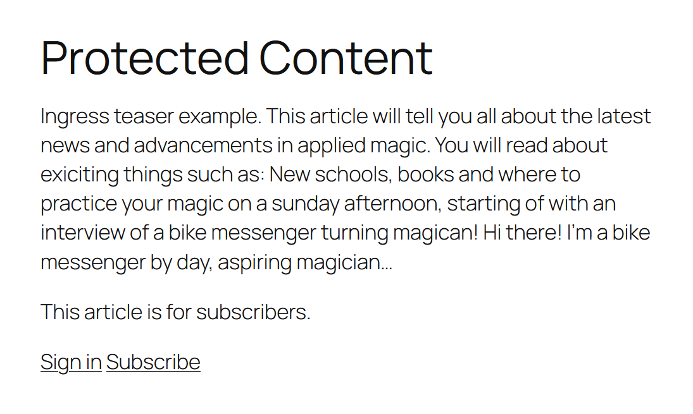
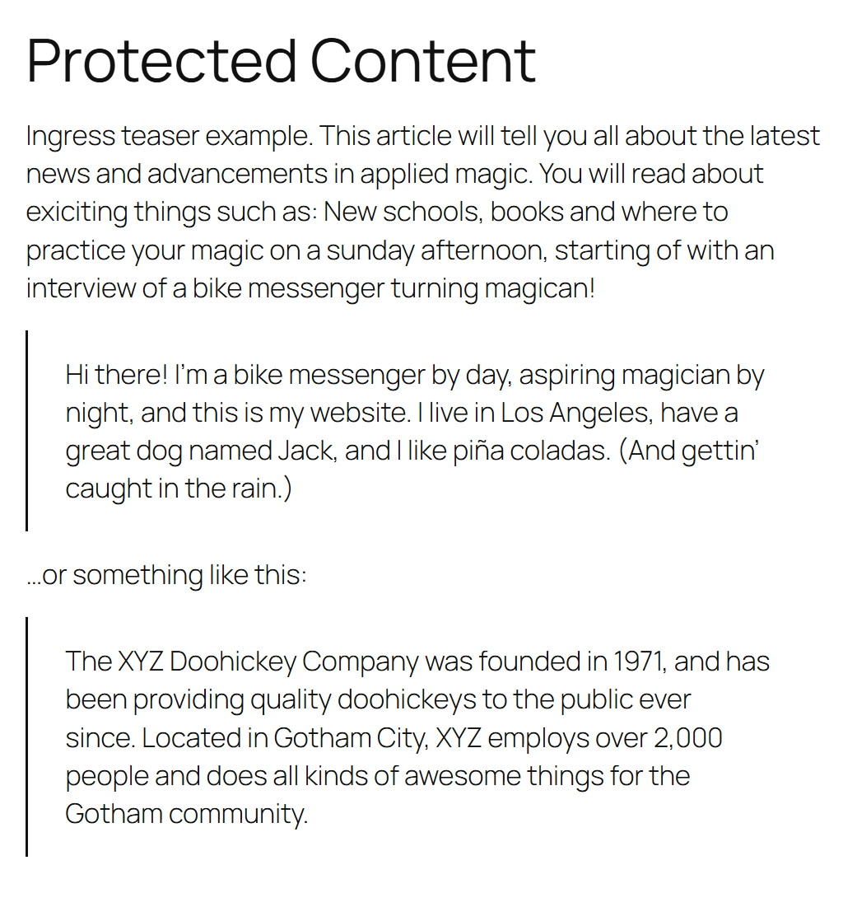

# INFO-Subscription Access for WordPress

Let visitors sign in with INFO-Subscription and restrict articles to signed-in
subscribers or subscribers holding **any one** of the selected products.
Subscribers do not need WordPress accounts.

**Status:** pre-release, verified against live INFO-Subscription sign-in and API.
Not yet in the WordPress.org plugin directory (waiting for a service privacy policy).

## Screenshots

| Before sign-in | After sign-in |
| --- | --- |
|  |  |

## Install

Requirements: WordPress 5.6+, PHP 8.0+, HTTPS, and INFO-Subscription application
registrations as described below.

1. Open [Releases](https://github.com/infosoftas/info-subscription-wordpress/releases)
   and download the attached **`infosub.zip`** from a published release.
2. In WordPress, open **Plugins -> Add New Plugin -> Upload Plugin**, select that
   ZIP, and choose **Install Now**, then **Activate Plugin**.
3. Open **Settings -> INFO-Subscription** and follow the configuration steps below.

Do **not** install GitHub's **Source code (zip)** or a **Code -> Download ZIP**
archive. Those contain source without the bundled dependencies and are not ready
to install. Composer is not needed when installing `infosub.zip`.

Until the first release is published, maintainers can build `infosub.zip` using
`composer build`, or download the `infosub` artifact from a successful
[Build and test](https://github.com/infosoftas/info-subscription-wordpress/actions/workflows/build.yml)
run. Extract the artifact archive once to get the installable `infosub.zip`.

## Configure

The plugin talks to **two different identity providers (Azure AD B2C)**. They use separate
application registrations and separate credentials.
Nothing is shared between them.

| | Subscriber sign-in (paywall) | API credentials (product list) |
|---|---|---|
| Identity provider | The tenant-specific instance (for testing: `experimentationS4prod`) | The main INFO-Subscription instance (`prodlogins4`), shared by all tenants |
| Authentication | Subscribers sign in on the public site | Administrator signs in interactively with OAuth2 `authorization_code` + PKCE (public client, no secret) |
| Needs an application registration | Yes, one per tenant/site | Yes, in the main instance |
| Redirect URI | `https://your-site/wp-json/infosub/v1/callback` | `https://your-site/wp-json/infosub/v1/api-callback` |
| Settings fields | Tenant name, policy, client ID (no secret: the plugin only needs the id_token) | INFO-Subscription tenant ID (`S4-TenantId`), API client ID (no secret) |
| What it produces | A subscriber session (cookie `infosub_sid`) with the products from the `extension_Products` claim | A cached list of products from `GET /product` (token used once, never stored) |
| Used by | Visitors reading protected articles | The "Subscription access" box when editing an article |

Product IDs from `GET /product` are the same IDs that appear in the `extension_Products` claim.

### Configuration steps

1. Install the plugin zip through *Plugins, Add New, Upload Plugin*, then activate it
   (PHP 8.0+). The zip already includes its dependencies; Composer is only needed to develop
   the plugin or build a release.
2. **Settings, INFO-Subscription, Subscriber sign-in:** enter the tenant name and client ID.
   The sign-in uses the OpenID Connect id_token flow (`response_type=id_token`,
   `response_mode=form_post`), so no client secret is needed, but the application
   registration must allow **ID tokens (implicit grant)**. Ask Infosoft to register the
   subscriber redirect URI shown on the page. The site must use HTTPS: the identity provider
   posts back cross-site, which needs a `SameSite=None; Secure` cookie. Press
   *Test connection*.
3. **Optional, Product list:** enter the tenant ID and the API client ID (from the
   application registered in the main instance). The application must be authorized to access
   this tenant and have the tenant-specific `ReadWriteAll` delegated permission. Register
   the API redirect URI shown on the page with that application under the **Mobile and
   desktop applications** platform (a public client): the plugin redeems the sign-in code
   with PKCE instead of a client secret. Press *Sign in and load products*. The requested
   scope is `openid profile` plus
   `https://prodlogins4.onmicrosoft.com/api/{S4-TenantId}.ReadWriteAll`; the tenant ID comes
   from the INFO-Subscription tenant ID setting. No `offline_access`: tokens are used once
   and never stored.
4. Edit an article and choose an access mode in the *Subscription access* box:
   **AllAccess** lets everyone read it. **UserLoggedIn** requires an active INFO-Subscription
   sign-in session, even if the visitor has no products; a WordPress login alone does not
   qualify. **SelectedProducts** shows the product controls and requires **any one** selected
   product. If the product list has not been loaded, enter product IDs one per line or
   separated by commas. Saving SelectedProducts without any products reports an error and
   keeps the previous access rule. Other modes remember the selected products but ignore them.

Existing articles keep their behavior: no access mode and no required products means public;
existing product requirements remain product-gated. Editors and administrators who can edit an
article can always preview it. Login-only articles show a sign-in prompt instead of a
subscription prompt; in redirect mode they send visitors to sign-in instead of checkout.

Values can also be fixed in `wp-config.php`: `INFOSUB_TENANT`, `INFOSUB_POLICY`,
`INFOSUB_CLIENT_ID`, `INFOSUB_API_TENANT_ID`,
`INFOSUB_API_CLIENT_ID`, `INFOSUB_API_REDIRECT_URI`.

## Update or uninstall

Back up the site and database before updating. Download the new release's
`infosub.zip`, upload it through **Plugins -> Add New Plugin -> Upload Plugin**,
and choose **Replace current with uploaded**. Settings and article access rules
are retained. GitHub releases are not automatically installed by WordPress.

Deleting the plugin removes its options and transients. Add
`define('INFOSUB_REMOVE_ALL_DATA', true);` before deleting to also remove the product
access mode and product requirements stored on each article.

## Diagnosing API authentication failures

If *Sign in and load products* fails during the token request, expand **Technical details**
below the error on the settings page. It shows the HTTP status, OAuth error and provider
description (including B2C error codes and correlation IDs when supplied), or the underlying
connection error. No debug logging is required.

If the token request succeeds (HTTP 200) but the access token is missing, the details list
the returned field names (never values) and show the requested scope. The API access token
is used once to load products; neither access nor refresh tokens are stored.
An API 403 means the application may not be authorized for the configured tenant.
A token error saying a client secret or assertion is required (`invalid_client`,
`AADSTS7000218`-style) means the API redirect URI is registered under the Web platform;
move it to *Mobile and desktop applications*.

Details are redacted, stored temporarily for up to ten minutes, and shown once, only to the
administrator who requested products. Error descriptions and credentials are not put in redirect
URLs; tokens and raw response bodies are not displayed. Retry loading products if details have
expired or already been viewed.

## Composer and release build

Install Composer, PHP 8.0+, `sh`, `curl`, and PHP's `zip` extension. On Windows, run the
commands from WSL or Git Bash. From the plugin source folder:

    composer install

This installs the exact dependencies recorded in `composer.lock`. The Composer install/update
scripts download [Strauss](https://github.com/BrianHenryIE/strauss) to `bin/` and prefix
dependencies in `vendor/` under `Infosub\Vendor\` (for example,
`\Infosub\Vendor\Firebase\JWT\JWT`). Keep references to bundled dependencies prefixed so
they cannot conflict with copies bundled by other plugins. Do not ship `composer.*` or
`bin/strauss.phar` to WordPress users; the release zip contains the built `vendor/` directory.

To create a release zip:

    composer build

This installs the locked runtime dependencies with `--no-dev`, runs Strauss, then writes
`dist/infosub.zip` with everything under an `infosub/` folder, minus files listed in
`.distignore` (`bin/`, `tests/`, `dist/`, `composer.*`, git files). Each build overwrites the
previous zip; the output shows the version from the `Version:` header in `infosub.php`.
Upload the zip through WordPress, or install it with
`wp plugin install dist/infosub.zip --force`.

## Tests and releases

Standalone tests, after checking out the source:

    php tests/gate-multiple-products.php
    php tests/meta-box-multiple-products.php

Integration tests require an **isolated test WordPress installation** with an
administrator and the built plugin active. Do not run them on production: they
temporarily change settings, cookies and cached data.

    wp eval-file tests/api-error-details.php --path=/path/to/test-wordpress
    wp eval-file tests/oidc-id-token-flow.php --path=/path/to/test-wordpress

GitHub Actions builds the ZIP and runs all four suites against PHP 8.0 and 8.4
with a fresh WordPress installation on pushes to `main` and pull requests. These
tests use synthetic identity-provider responses; they do not verify live B2C
application registrations or real tenant access.

To prepare a release:

1. Update both the `Version:` header and `INFOSUB_VERSION` in `infosub.php`, and the
   `Stable tag:` and changelog in `readme.txt`.
2. Commit, then push a matching version tag, for example `v0.1.0`.
3. Actions verifies the tag and Stable tag match the version, builds and tests the plugin, then creates a
   **draft GitHub release** with `infosub.zip` attached.
4. Review release notes and verify real subscriber sign-in, API product loading
   and article access in a staging site before publishing the draft.

`readme.txt` is the WordPress.org plugin directory readme (shipped in the zip); this
`README.md` is for GitHub. Before submitting to or updating WordPress.org, run
[Plugin Check](https://wordpress.org/plugins/plugin-check/) on the built plugin; it must
report no errors.

## License

MIT. See [LICENSE](LICENSE). Bundled dependencies retain their own license notices.
